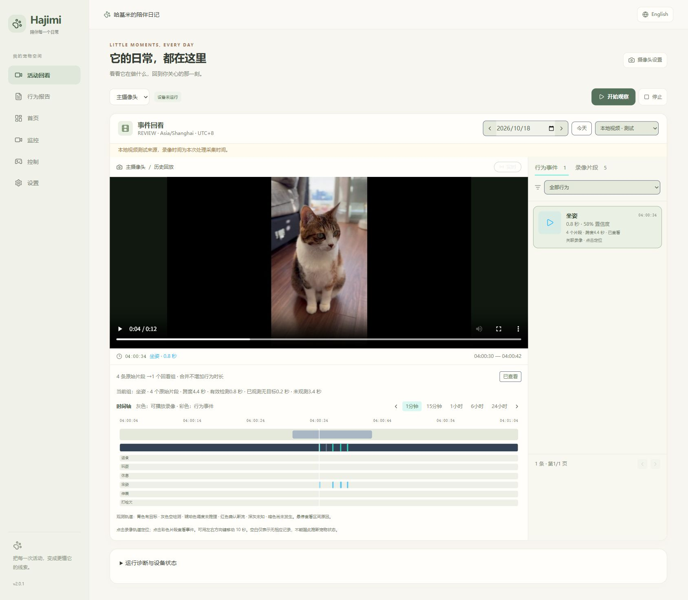
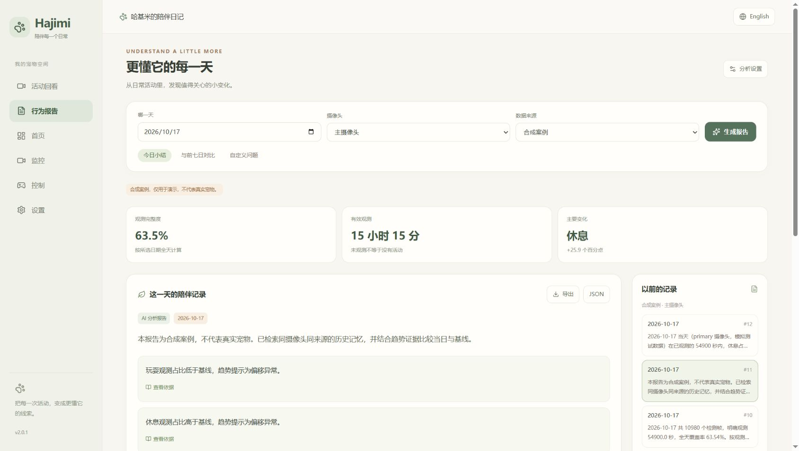

<div align="right">

[English](./README.md) | [简体中文](./README.zh-CN.md)

</div>

<div align="center">
  
</div>

# HajimiRobot — AI 智能移动宠物陪护机器人

## 2.0.1 · 本机 NVR 与行为报告

面向日常看护的简洁控制台：运动调度GPU YOLO、保留证据的事件回看、SQLite记忆、本地CPU嵌入与Qdrant、LangGraph + DeepSeek报告。无需Jetson即可运行桌面链路。

```powershell
powershell -ExecutionPolicy Bypass -File scripts/setup.ps1
powershell -ExecutionPolicy Bypass -File scripts/start.ps1
```

打开 http://127.0.0.1:3000 。自行提供六类权重和视频；无Key可生成统计报告，DeepSeek为可选云端生成。密钥和运行数据不随源码发布。

[Quick start](docs/zh/quickstart.md) · [User guide](docs/zh/user-guide.md) · [Architecture](docs/zh/architecture.md) · [API](docs/zh/api.md) · [Documentation](docs/zh/README.md) · [Changelog](CHANGELOG.md)




**机器人控制 · 嵌入式开发 · 边缘 AI · 计算机视觉 · AIoT 全栈工程实践**

HajimiRobot 是 **电子科技大学（UESTC）× 法国 ESIGELEC** 项目背景下的团队工程原型，结合 Jetson Nano、STM32F407、全向移动底盘、双轴云台、投喂执行机构、YOLO26 猫咪行为识别，以及 Web 远程监控与控制平台。

**问题定义：** 传统固定式喂食器、宠物摄像头通常只能解决单一需求，难以覆盖跨房间观察、移动交互与行为理解。本项目探索将**移动监控、远程投喂、视觉识别、行为记录与可视化报告**整合在一套机器人平台中。

> **项目边界：** 当前定位为课程/科研工程原型，并非已量产或通过产品认证的宠物设备。本文明确区分代码已包含的功能、项目展示中的实验结果和未来规划。

## 一、核心技术与工程成果

| 模块 | 技术 / 工程实践 |
|---|---|
| 硬件平台 | Jetson Nano A02 + STM32F407、全向底盘、投喂机构 |
| 嵌入式接口 | HC-05 蓝牙、I2C、PCA9685、MG90S、PWM/GPIO |
| Jetson 服务 | Python FastAPI Bridge、双路 MJPEG 视频、systemd |
| Web 全栈 | React 19、TypeScript、Vite、Tailwind CSS 4、Express |
| 视觉 AI | YOLO26 六类猫行为识别、ONNX、TensorRT FP16 |
| 模型优化 | 小波特征蒸馏 WFD：YOLO26x 教师 → YOLO26n 学生 |
| 工程方法 | 模块拆解、硬件联调、接口测试、推理测量、迭代优化 |

## 二、机器人硬件架构与模块分工

~~~text
React / TypeScript Web 控制台
               |
          HTTP / WebSocket
               |
      Express 本地后端 (:3001)
               |
       +-------+--------------------+
       |                            |
  摄像头服务                  Jetson FastAPI Bridge
  (:5000 / :5001)                 (:8000)
                                    |
                  +-----------------+-----------------+
                  |                                   |
          I2C → PCA9685                       蓝牙 HC-05
          → MG90S 云台                             |
                                              STM32F407
                                                   |
                                         移动底盘 / 投喂控制
~~~

**核心设计思想：** Jetson 负责视频、AI 推理与业务协调；STM32 负责底层执行控制。前端通过本地服务调用硬件接口，降低 UI、边缘算法与执行器的耦合。

工程入口：[Web-Console](./Web-Console/README.zh-CN.md) ｜ [Jetson-Edge](./Jetson-Edge/README.zh-CN.md) ｜ [Hardware](./Hardware/README.zh-CN.md)

### 2.1 嵌入式和电子硬件

- STM32F407 负责小车运动与投喂控制相关固件，通过 HC-05 与 Jetson 通信。
- PCA9685 驱动双轴 MG90S 云台，实现摄像头方向调节。
- 项目涉及电源分配、I2C 设备寻址、通信链路、PWM 舵机限幅及软硬件联合调试。
- 项目答辩材料展示了基于 KiCad 的自定义 STM32 控制板与制造流程，**PCB 设计、制造、焊接和调试是团队协作成果**。当前公开仓库的 Hardware 目录主要包含小车控制工程，不能等同于完整 PCB 生产资料已开源。

**实际调试示例：** 在测试使用的 Jetson 装配中，bus 0 扫描到与 PCA9685 相关的 0x40/0x70 地址；云台限幅参数记录为 PAN 710–2250 μs、TILT 970–2220 μs。其他硬件应先重新测量和标定，不可直接照搬。

**供电安全：** PCA9685 的逻辑 VCC 与舵机 V+ 必须区分。舵机使用满足电流要求的独立供电并与控制器共地，不应直接通过 Jetson GPIO 为舵机供电。

### 2.2 YOLO26 六类猫行为识别

识别类别：**eating、playing、rest、sitting、stretching、yawning**（进食、玩耍、休息、坐姿、伸展、打哈欠）。

2026 年 9 月项目答辩材料记录了 **8,149 张图像**及 **70%/20%/10% 的训练、验证、测试集划分**，并展示数据标注、YOLO26 训练、模型评估到边缘部署的流程。

#### 小波特征蒸馏（WFD）

采用 YOLO26x 教师模型对 YOLO26n 学生模型进行频域特征指导，提高轻量模型的识别效果。**蒸馏仅参与训练**，部署推理时仍是标准 YOLO26n 结构。

| 模型 | 参数量 | FLOPs | 测试集 mAP50-95 |
|---|---:|---:|---:|
| YOLO26n 基线 | 2.4M | 5.4B | 0.827 |
| YOLO26n + 常规 KD | 2.4M | 5.4B | 0.829 |
| YOLO26n + WFD | 2.4M | 5.4B | **0.843** |
| YOLO26x 教师 | 55.7M | 193.9B | 0.859 |

**结果：** WFD 使学生模型测试 mAP50-95 从 **0.827 提升到 0.843（提高 1.6 个百分点）**；与 YOLO26x 对比，YOLO26n 的参数量和 FLOPs 分别减少约 **95.7%** 和 **97.2%**。

可查阅：[YOLO26 轻量化实验](./Yolo26/yolo26-cat-lightweight/README.zh-CN.md) ｜ [权重清单](./Yolo26/yolo26-cat-lightweight/weights_manifest.md)

**可复现性说明：** 公开仓库未包含大型训练数据、权重、ONNX 和 TensorRT Engine，因此这些数据属于已记录的实验结果，不代表克隆仓库后即可一键复现实验。

### 2.3 Jetson Nano 边缘推理优化

针对 **Jetson Nano A02、FP16、batch=1、输入 320** 的测试配置：

| 性能指标 | ONNX Runtime | TensorRT FP16 |
|---|---:|---:|
| 模型推理延迟 | 45.3 ms | **17.5 ms** |
| 端到端延迟 | 139.6 ms | **127.4 ms** |
| 端到端吞吐 | 7.2 FPS | **7.8 FPS** |

**模型推理阶段约加速 2.6 倍**；但考虑视频采集、前后处理等开销，**端到端延迟只降低约 8.7%**。不能将这两个指标混为一谈，也不能直接与其他 GPU 平台的延迟比较。

### 2.4 Web 控制台与行为报告

仓库已包含以下功能模块：

- Dashboard、Monitor、Control、Reports、Settings 页面。
- 双路 MJPEG 视频监控、本地录像、小车与云台控制界面。
- 投喂及自动追踪控制接口。
- YOLO 行为事件记录、行为时间线与日报可视化。
- 中英文界面切换。

行为历史日志对**相同类别的事件设置约 1 小时的重复记录冷却时间**，用于减少时间轴冗余。该机制记录的是抽样/事件，**不能作为连续真实行为时长的测量结果**。

视频、执行器与喂食等功能需要实际 Jetson、摄像头、STM32 和机械机构在线；接口存在不等同于所有硬件动作均完成了长期可靠性测试。

## 三、仓库结构

~~~text
HajimiRobot/
├── assets/                    # 项目 Logo
├── Hardware/                  # STM32 小车控制工程
│   └── car_ctl/
├── Jetson-Edge/               # 摄像头、Bridge、部署脚本
│   └── jetson_services_bundle/
├── Web-Console/               # React 前端 + Express 后端
│   ├── src/
│   ├── server/
│   ├── scripts/
│   └── docs/
├── Yolo26/                    # YOLO26 实验资料
│   └── yolo26-cat-lightweight/
├── README.md
└── README.zh-CN.md
~~~

完整模块说明：[Web 控制台](./Web-Console/README.zh-CN.md) ｜ [Jetson 端服务](./Jetson-Edge/README.zh-CN.md) ｜ [STM32 硬件](./Hardware/README.zh-CN.md) ｜ [YOLO26](./Yolo26/README.zh-CN.md) ｜ [工程联调记录](./Web-Console/docs/project-and-jetson-integration-summary-2026-06-24.md)

## 四、快速运行：Web Console

Web 页面开发需要 Node.js/npm；**要联动实物，还需完成 Jetson 服务、摄像头和 STM32 固件部署**。

~~~bash
git clone https://github.com/shiyi-ale/HajimiRobot.git
cd HajimiRobot/Web-Console
npm install
cp .env.example .env.local
~~~

根据**自己的局域网配置**修改 `.env.local`：

~~~dotenv
VITE_BACKEND_ORIGIN="http://127.0.0.1:3001"
JETSON_CAMERA_BASE_URL="http://<jetson-ip>:5000"
JETSON_CAMERA_2_BASE_URL="http://<jetson-ip>:5001"
JETSON_BRIDGE_BASE_URL="http://<jetson-ip>:8000"
~~~

分别在两个终端运行：

~~~bash
npm run dev
~~~

~~~bash
npm run dev:server
~~~

代码检查：

~~~bash
npm run lint
~~~

对于已正确部署的 Jetson，可检查：

~~~bash
systemctl --user status hajimi-bridge.service
curl http://127.0.0.1:8000/healthz
curl http://127.0.0.1:8000/api/status
~~~

以上是 **Web 项目的快速启动方式**，不是包含电路焊接、固件烧录、模型训练的整机自动部署流程。

## 五、工程实现与测试思路

项目从单点功能走向系统集成，大致遵循以下流程：

1. **需求与竞品：** 分析固定式喂食器、宠物摄像头、移动宠物机器人与 AI 应用的能力边界。
2. **架构设计：** 拆分前端、后端、Jetson、STM32、传感/执行机构的职责。
3. **原型构建：** 硬件连接、控制固件、视频服务、Web UI、模型训练分别开发。
4. **联调排障：** 检测电源、电机/舵机、I2C、蓝牙、接口返回值和视频链路。
5. **性能优化：** 使用 WFD 训练轻量模型，比较 ONNX 与 TensorRT 的速度和系统整体开销。
6. **记录与迭代：** 记录问题、实验结果、接口与后续待改进点。
7. **成果展示：** 通过真实原型、Web 界面、行为报告和技术答辩解释实现过程。

后续工程验收可以围绕**供电与接线、急停响应、舵机标定、蓝牙命令可靠性、视频稳定性、投喂重复性、类别识别表现及端到端性能**建立检查表。此处属于建议测试框架，**不意味着所有项目均已构建成自动化测试套件**。

## 六、已记录成果与下一阶段方向

**公开仓库/项目展示中已有：** Web 控制台、Jetson Camera/Bridge、STM32 控制工程、云台/底盘/喂食的接口联动、六类 YOLO 实验、WFD 训练结果、TensorRT 性能测量与行为事件报告链路。各模块开源完整度不同。

**后续规划而非已交付能力：** 自动回充、稳定自主找宠/避障、多宠身份识别、原生手机 App、长期异常行为检测、个体宠物画像，以及更完整的智能体记忆与护理策略。

## 八、团队协作与个人职责

**赵杭键（Zhao Hangjian）｜软件开发/嵌入式开发/ AI 算法工程**

项目答辩材料中的个人职责：**软件开发、系统集成、AI 算法设计**。PCB、硬件装配与调试、产品方案、项目计划等由团队不同成员协作完成，不将团队的全部成果归为个人独立开发。

项目背景：**电子科技大学（UESTC）× ESIGELEC（法国）**  
指导教师：**Louis Lecrosnier**  
项目答辩日期：**2026 年 9 月 1 日**

---

**HajimiRobot：让感知、控制与工程实践形成完整闭环。**
