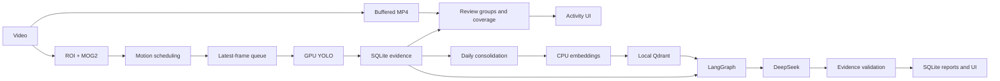

[Docs](README.md) · [简体中文](../zh/architecture.md)

# End-to-end architecture

React handles interaction; Express proxies /api/v1; FastAPI owns video, storage, tasks and the Agent. The existing Jetson-to-STM32 hardware path remains.

## NVR
Reduced frames undergo ROI-constrained MOG2, shadow filtering and morphology at five FPS. Idle/candidate/active inference requests run at 0.2/1/5 FPS. Warmup, lighting changes and gimbal movement reset backgrounds. A capacity-one queue replaces stale work. Sparse probes do not imply continuous observation.

Recording defaults to five seconds before and ten after triggers, overlap extension and sixty-second files. Seven days or ten GB per camera triggers cleanup, whichever comes first. Review groups are separate from files; seamless cross-file playback is not implemented.

## Agent
Fixed flow: validate request, query SQLite for the day and previous seven days, retrieve memories, compute trends, call DeepSeek, validate structure/numbers/citations, persist. The model does not freely execute SQL.

Daily memories carry dates, coverage, samples and references. Local CPU BGE produces 512-dimensional vectors. Persistent Qdrant upserts date/camera/source UUIDs. Late evidence marks dirty memories; changing models selects another collection. Retrieve at most five earlier matching-camera/source memories with 50% coverage by default.

DeepSeek receives questions, statistics, bounded events and memories, not video or weights. Prompts constrain uncertainty and diagnosis claims. Numeric/citation checks do not prove all prose correct; failures fall back to statistics.

## Measurement
Capture uses UTC; aggregation defaults to Asia/Shanghai. Explicit intervals establish duration without overlapping double counts. Empty inference differs from unknown gaps. Baselines average eligible daily shares; current coverage must reach 50%, with three valid historical days. Ten-percentage-point shifts are hints only.

frames/events/clips retain facts; review groups, coverage and snapshots are materialized on demand. Operational intervals record measured states. Unchanged history reuses snapshots; clock-only changes cache for fifteen seconds. Raw evidence lacks automatic long-term archival.
