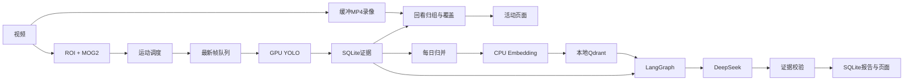

[Docs](README.md) · [English](../en/architecture.md)

# 全流程技术路线

React负责交互，Express代理/api/v1，FastAPI承担视频、存储、任务和Agent。既有Jetson→STM32硬件链路保留。

## NVR
默认5FPS缩小画面做ROI内MOG2、阴影过滤和形态学去噪；静止/候选/持续运动分别请求0.2/1/5FPS推理。预热、光照突变和云台移动重置背景。容量1队列替换旧帧，不堆积。低频探测不意味着连续观测。

录像默认前5秒后10秒、重叠触发延长、最长60秒分段；每摄像头7天或10GB先到者清理。浏览组和物理录像分开，不承诺跨文件无缝播放。

## Agent
固定流程：校验参数→SQLite当天及前7日→语义检索→确定性趋势→DeepSeek→结构/数字/引用校验→保存。不是模型自由执行SQL。

每日归并带日期、覆盖、样本与事件引用。BGE中文模型在CPU生成512维向量，Qdrant本地持久化；按日期/摄像头/来源固定UUID更新。迟到标脏并重算，换模型切换集合。检索同摄像头同来源、早于报告日、覆盖至少50%的最多5条记忆。

DeepSeek接收问题、统计、部分事件和记忆，不上传原视频或权重。提示词约束不确定性和医学结论；数字与引用校验不等于完整逻辑证明，失败回退统计。

## 口径
输入UTC，默认按Asia/Shanghai汇总。明确区间累计时长，重叠不重复；空检测与未知不同。基线取有效历史日占比算术平均；当天覆盖至少50%，有效历史日最少3天，10个百分点变化仅作提示。

frames/events/clips保留事实，review_groups/coverage_spans/timeline_snapshots按需物化。operational_intervals记录实测状态。不变历史复用快照，当天纯时间推进缓存最多15秒。原始帧尚无长期自动归档。
